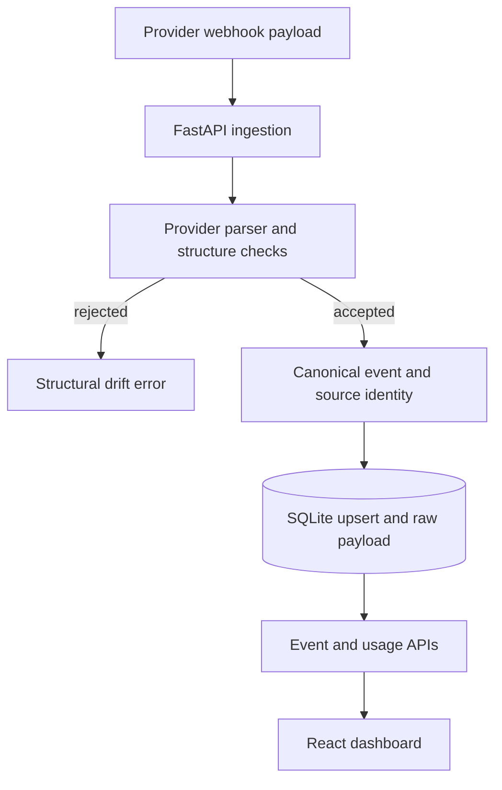

# Oximy Core

Oximy Core normalizes AI-provider usage events into a common schema for local analytics.

Usage data arrives with provider-specific field names, redeliveries and facts that become available later. Oximy puts that variability at the parsing boundary. Downstream metrics read a canonical event record rather than duplicating provider assumptions throughout the application.

[Quick start](#quick-start) · [Architecture](#architecture-and-request-flow) · [Development](#development) · [Contributing](CONTRIBUTING.md)

## Capabilities

| Workflow | Result |
|---|---|
| Normalize events | Keep provider-specific usage fields behind parser adapters. |
| Reconcile facts | Upsert stable event identities and selected late-arriving fields. |
| Inspect usage | Expose stored events and aggregates through the local API and dashboard. |

## Quick start

Use Python with the checked-in requirements and Node.js for the dashboard. SQLite is included with Python. No external warehouse or message broker is needed for the local example.

From a fresh checkout:

```bash
git clone https://github.com/ryash14/Oximy.git
cd Oximy
python3 -m venv .venv
source .venv/bin/activate
python -m pip install -r requirements.txt
python -m uvicorn api:app --host 127.0.0.1 --port 8000
# In another terminal: cd frontend && npm install && npm run dev
```

SQLite is supplied by Python; do not install a package named sqlite3. This is a local proof of concept with simulation endpoints and permissive CORS. It has no demonstrated distributed exactly-once guarantee or production authentication boundary. Inspect the frontend API configuration before using a separate host.

## Inspect a local run

Start the API and open `http://127.0.0.1:8000/docs`. The event and metric endpoints expose the records in the local SQLite database. Use the dashboard's simulation controls to compare an initial event, a redelivery and a late-cost update. Inspect the stored row and aggregate metrics after each step.

The database file is `oximy_events.db` in the working directory. Keep real provider payloads and identities out of public screenshots or issue reports. `replay.py` and `seed.py` provide additional experiment entrypoints; read their effects before running them against a database you want to preserve.

## Architecture and request flow

1. A provider payload reaches the FastAPI ingestion path.
2. The parser registry selects a provider adapter and checks required structure.
3. A canonical event is assigned a source-based identity and upserted into SQLite.
4. Metrics and event APIs expose the stored data to the React dashboard.

### Component model



### Engineering decisions

For stable provider event IDs, the store hashes `source::source_event_id` and updates selected late-arriving facts without inserting another row. The raw payload is preserved for inspection. A missing Gemini event ID currently falls back to a timestamp-derived ID, so deduplication is not guaranteed for that case.

Drift checks are provider-specific and incomplete: some nested usage values still default to zero. This is a schema-normalization proof of concept, not a distributed exactly-once ingestion system.

## Implementation

**Stack:** Python · FastAPI · Pydantic · SQLite · React · Vite.

- [parsers.py](parsers.py)
- [database.py](database.py)
- [metrics.py](metrics.py)
- [replay.py](replay.py)

## Development

There is no complete automated verification command documented for this application. Start the affected component, use a small synthetic input and inspect its output before changing integrations. The contribution guide describes the evidence expected in a pull request.

## Contributing and support

Report reproducible bugs or propose changes through [GitHub Issues](https://github.com/ryash14/Oximy/issues). Include the relevant environment and a small example rather than private datasets or credentials. See [contributing](CONTRIBUTING.md), [security reporting](SECURITY.md) and the [code of conduct](CODE_OF_CONDUCT.md).

## License

No repository-wide license is currently provided. Third-party components, models and datasets retain their own terms.
