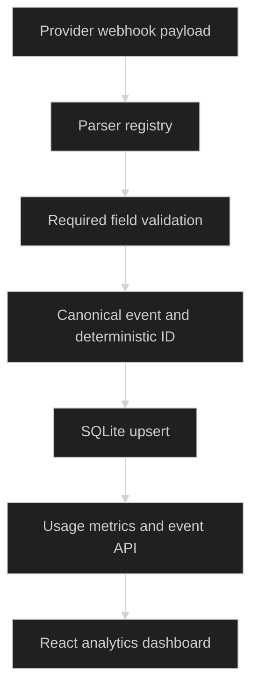

# Oximy Core

> `Canonical AI usage events with provider parsing, idempotent storage and drift rejection.`

### 🏗️ System Architecture



### 🛠️ Production Stack

Python · FastAPI · Pydantic · SQLite · React · Vite

### ⚡ Key Engineering Capabilities

- Provider-specific parsers normalize usage into a shared event shape.
- Deterministic event identity supports redelivery and late fact updates.
- Structural drift is rejected at parsing boundaries before normal ingestion.

### 🚀 Deployment and Local Setup

Run from the repository root after cloning:

```bash
git clone https://github.com/ryash14/Oximy.git
cd Oximy
python3 -m venv .venv
source .venv/bin/activate
python -m pip install -r requirements.txt
python -m uvicorn api:app --host 127.0.0.1 --port 8000
# In another terminal: cd frontend && npm install && npm run dev
```

SQLite is supplied by Python; do not install a package named sqlite3. This is a local proof of concept with simulation endpoints and permissive CORS. It has no demonstrated distributed exactly-once guarantee or production authentication boundary. Inspect the frontend API configuration before using a separate host.

### Source Map

- [parsers.py](parsers.py)
- [database.py](database.py)
- [metrics.py](metrics.py)
- [replay.py](replay.py)
